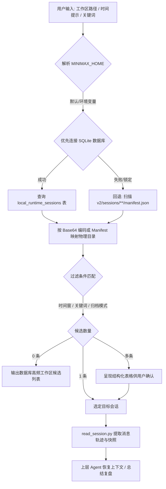

# skill-minimax-code-session-locator

> 仓库公开地址：https://github.com/JasonCai2024/skill-minimax-code-session-locator  
> 一键克隆命令：`git clone https://github.com/JasonCai2024/skill-minimax-code-session-locator.git`

按工作区路径、时间窗、归档状态与全文关键词快速定位本地 MiniMax Code（Mavis / OpenCode 运行时）会话，并提取结构化对话轨迹与状态快照。

---

## 项目简介与核心卖点

MiniMax Code 采用“全局 SQLite 关系库（`runtime-state.sqlite`）+ 按日期分层的会话文件目录（`v2/sessions/`）”的混合架构。本技能针对开发者与多智能体接力场景设计：

1. **秒级多维定位**：基于 `runtime-state.sqlite` 索引支持按工作区路径、自然语言更新时间、归档状态与标题快速过滤。
2. **双模寻址引擎**：优先通过 SQLite 关系表高速检索，当数据库不可用时自动回退为基于文件系统的 `manifest.json` 扫描，保证高可用性。
3. **完整轨迹与快照还原**：一键解析 `messages.jsonl`（含思考推理流 Thinking、工具调用序列与用户提问），支持查验 `snapshot.json` 上下文快照与 `reports/` 交付报告。

---

## Mermaid 业务流程图



---

## 获取与安装配置

### 1. 放置到技能目录
```powershell
# 克隆至本地
git clone https://github.com/JasonCai2024/skill-minimax-code-session-locator.git

# 部署至 Claude Code 项目级或全局技能库
cp -r skill-minimax-code-session-locator ~/.claude/skills/
```

### 2. 环境依赖与健康探活
- **环境依赖**：Python 3.8+（仅使用 Python 标准库 `sqlite3`、`json`、`re`、`base64`、`datetime`、`pathlib`，**零外部 pip 依赖**）。
- **一键健康探活命令**：
```powershell
python scripts/locate_session.py --limit 1
```
*控制台成功输出最近 1 条 MiniMax Code 会话即表示安装与环境验证通过。*

---

## 使用说明

### 1. 能做什么与怎么对 AI 助理说

| 能力名称 | 自然语言提示词触发话术 (对 AI 助理说) | 底层 CLI 执行命令 |
| :--- | :--- | :--- |
| **按项目定位会话** | “帮我找到昨天在 `E:/BaiduSyncdisk/WorkSpace/ForAgent` 运行的 MiniMax 会话” | `python scripts/locate_session.py --workspace "ForAgent" --time "yesterday"` |
| **检索已归档会话** | “列出 MiniMax Code 中已归档的历史会话，找一下关键词‘技能’” | `python scripts/locate_session.py --archived-only --keyword "技能"` |
| **查阅会话摘要与快照** | “查看会话 `mvs_2c410550...` 的对话轮次统计与快照状态” | `python scripts/read_session.py --session-id mvs_2c410550... --summary` |
| **逐轮复现交互细节** | “查看会话 `mvs_2c410550...` 的第 3 轮交互与思考过程” | `python scripts/read_session.py --session-id mvs_2c410550... --turn 3` |
| **程序化 JSON 消费** | “以 JSON 格式输出工作区社交媒体最近的 3 个活跃会话” | `python scripts/locate_session.py --workspace "社交媒体" --active-only --limit 3 --json` |

### 2. 典型实战场景工作流

#### 场景 A：跨智能体开发接力
1. 开发者在 MiniMax Code (Mavis) 中让 Agent 编写并测试了一组代码，随后需要在 Claude Code 中继续。
2. 告知 Claude Code：“帮我查下 MiniMax 刚刚在当前工作区完成了什么”。
3. Claude Code 执行 `locate_session.py` 定位目标会话，并调用 `read_session.py --summary` 快速提取最后数轮的思考与工具输出，无缝接力。

#### 场景 B：历史长对话重点排查
1. 某次任务执行了 100 多轮对话，需要精准定位某一次关键的思考推理或工具报错。
2. Agent 执行 `python scripts/locate_session.py --keyword "SyntaxError" --limit 3`。
3. 执行 `python scripts/read_session.py --session-id <id> --turn <N>` 展开该轮次完整的输入参数与报错堆栈。

---

## 凭证安全与隔离规范

- **纯本地只读分析**：本技能仅对本地 SQLite 与会话 JSONL 进行只读探测，不发起网络请求，不采集任何用户 API Key。
- **凭证物理隔离**：不硬编码任何凭据。支持通过 `.env` 自定义主目录，`.gitignore` 严格忽略本地凭证与临时文件。
- **数据一致性保护**：所有读取均采用只读连接，绝不改写原数据文件。

---

## 文件目录结构与核心设计决策

### 文件目录结构
```text
skill-minimax-code-session-locator/
├── SKILL.md                 # 技能核心工作说明书
├── README.md                # 统一指引与标准文档
├── INSTALL.md               # 本地部署与手动调用指南
├── .env.example             # 环境变量示例
├── .gitignore               # 忽略规则
├── scripts/
│   ├── locate_session.py    # 双模会话快速定位脚本
│   └── read_session.py      # 对话消息与快照提取脚本
└── references/
    ├── minimax-storage.md   # 存储架构与按日期分层目录说明
    └── sqlite-schema.md     # runtime-state.sqlite 关系与 FTS5 表规格
```

### 核心设计决策
1. **创建时间与更新时间解耦**：精准适配 MiniMax Code 目录名固定为首次创建时间、会话追加不移动目录的特点，以数据库中的 `updated_at_ms` 作为核心时间判定基准。
2. **Base64 物理目录秒级映射**：利用 MiniMax 会话目录名后缀为 Base64 编码 ID 的特性实现快速反查，避免全盘递归扫描。
3. **文本与思维链智能分离**：在解析 `messages.jsonl` 时自动分离提取文本正文与 `thinking` 思考过程，提供干净易读的交互视图。

---

## 许可证

MIT License
